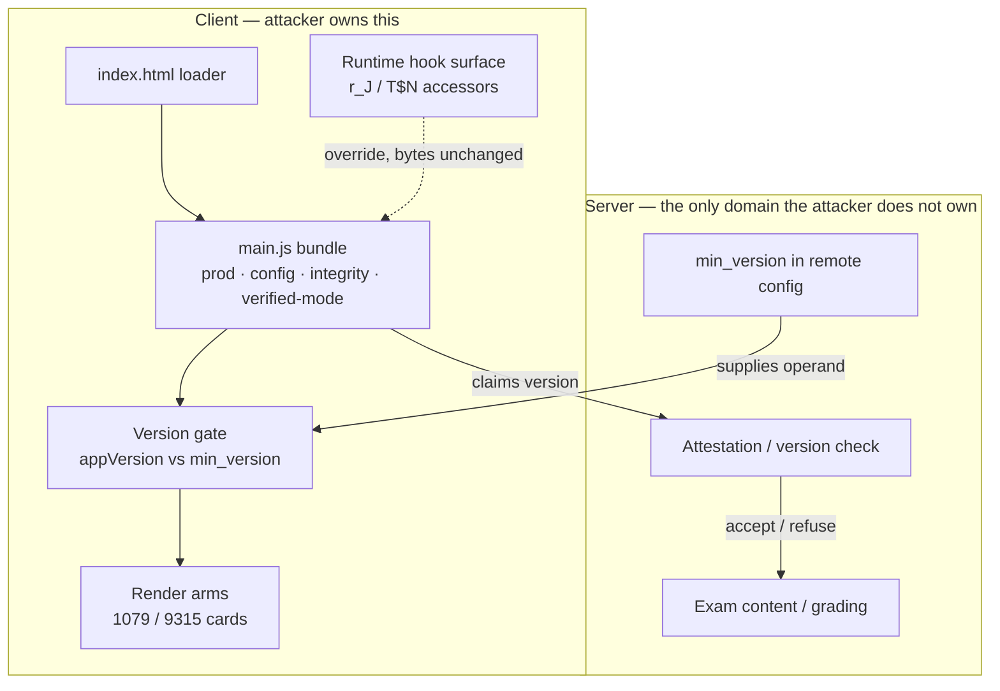

# Client-Side Boot Gate: Bypass Analysis

**Subject:** Bluebook client bundle boot gate — integrity, verified-mode, and version-gate subsystems
**Companion to:** *Bundle Gate Report* (architecture and string anchors)
**Scope:** Threat model of the client-side checks described in the bundle report, ranked bypass paths, and the server-side controls that actually hold.

---

## 0. Workspace verification (read-only pass)

A read-only pass over `clean/main.js` and `strings.current.json` corrects three framings below. The structural argument is unchanged.

- The indices are keys into the canonical table, not positions. Lookup is `table[str(idx)]`; positional lookup returns the wrong string: 1079 positionally is `captureScreen`, by key it is the outdated-version card.
- 5252 is assigned to `L6q.YJh` at line 14356 and invoked at 57498. 2348 binds reducer value `N37` at line 36116, from the `useReducer` at 34852. The predicate body `L6q.YJh` sits in webpack module `o4E(18973)`, referenced at line 10068, and is not yet extracted.
- The obfuscation hides the accessor call, not the string. `appVersion`, `min_version`, `forceUpdate`, `checkUpdateRequired` and both card bodies are stored verbatim and resolve by key.

Tier 0 below therefore targets `L6q.YJh` and the `N37` reducer branch, or the invocation at 57498, not the string-table indices.

---

## 1. Summary

Nothing in the gate as described is a wall. Every check — production, config, integrity, verified-mode, and the version gate — lives in the same trust domain as the code it guards: the client. The bundle report's §6 and §9 are, functionally, the bypass recipe already written down.

The honest answer to *"what would an attacker have to do?"* is: **exactly what was already done twice, one more time** — with cheaper alternatives that do not require editing the bundle at all.

The interesting question is not *whether* the gate falls. It is *which layer you attack*, and *what the server still catches*.

---

## 2. The Structural Problem: One Trust Domain

The integrity check is the tell: it recomputes a signature and compares it against an expected value **baked into the same bundle**. Verifier and verified ship together, so the expected value is as patchable as the code it validates.

That is not an implementation bug. It is the ceiling of client-side enforcement.

---

## 3. The Bypass Ladder (cheapest first)

| Tier | Move | Defeats | Cost |
|------|------|---------|------|
| **0** | Flip `checkUpdateRequired` (5252) to false; force `forceUpdate` (2348) false | Version gate, both arms at once | Two surgical edits, tens of bytes — the bundle report's own §9 |
| **1** | Change the operands: bump `appVersion` (157), or rewrite `min_version` (2205) to `0` in the config response | The version comparison without touching the predicate | One constant, or one intercepted response |
| **2** | Suppress the render: patch string-table entries 1079 / 9315, or unhook the card mount | The visible block, independent of the predicate | Requires resolving indices — but the table is already recovered in `strings.current.json` |
| **3** | **Runtime hook:** override `r_J` / `T$N`, or the compare itself, from a loader injection, extension, or proxy | Integrity too — bundle bytes never change, so the signature still validates | Medium; the elegant bypass |
| **4** | Transport / loader substitution: DevTools local overrides, MITM proxy, service worker, modified `index.html` | Bundle-only integrity entirely | Low-to-medium, depending on CSP and cache-busting |
| **5** | TOCTOU: let the one-shot boot checks pass, then patch after they run | Any check that only fires at startup | Depends on whether checks re-run |

**Tier 0** is what the bundle report prescribes. It works because the version gate is a *single predicate upstream of both cards* — one branch flip clears 1079 and 9315 together, the same shape as the integrity short-circuit already applied.

**Tier 3** is the one worth dwelling on. If integrity is a byte-hash over `main.js` checked once at boot, then a runtime override of the accessor functions leaves the hash valid while changing behavior. The obfuscation does not stop this: the index table is fully recoverable, and the accessors are just functions.

That is why the bundle report's §7 open question matters: *does the signature cover only the bundle, or bundle + config — and is it re-checked?*

---

## 4. Why Each Control Falls

| Control | Why it falls |
|---------|--------------|
| **Production / config checks** | Client-side constants and client-parsed config. They gate the UI, nothing more. |
| **Integrity check** | Self-referential (expected value lives in the artifact), one-shot at boot, and bypassable at Tier 3 without touching bytes. The existing patch (short-circuit true) already proved the expected value is editable. |
| **Verified-mode check** | A client-side boolean. Already forced true. |
| **Version gate** | A comparison whose *both* operands are attacker-reachable: `appVersion` is read from the app; `min_version` arrives over the network. Patch the predicate (Tier 0), the operand (Tier 1), or the transport (Tier 4). |
| **Obfuscation** | Raises the cost of *finding* the patch point, not the cost of *applying* it. The bundle report itself demonstrates the table is transparent once indexed. |

---

## 5. The Ceiling: The Server

Every tier above gets you a **booted UI**. It does not get you exam content if the server independently checks.

The version gate's dependence on a server-supplied `min_version` is a hint the backend may already re-verify — and that is the only control that actually holds.

So the meaningful question for an attacker is not *"can I patch the client"* (yes, trivially), but:

> **Does the server refuse to serve content or accept submissions from a stale or tampered client?**

If yes, Tiers 0–3 produce a working shell and no exam.
If no, the entire gate is theater.

That reframes the bundle report's §7 open questions as the real ones:

1. Is the integrity hash input bundle-only, or bundle + config?
2. Does the server independently re-verify client version and capability, out-of-band?

---

## 6. What Would Actually Stop It

- **Server-side enforcement of the version gate.** Withhold exam content and reject submissions from clients below `min_version`. Check on every request, not just at boot.
- **Attestation.** A signed challenge-response (WebAuthn / hardware-backed) so the client cannot lie about its own version. The key never lives in the bundle.
- **Asymmetric integrity.** Sign with a private key the client never holds, so the expected value cannot be patched in-artifact.
- **Cover the loader and runtime; re-check periodically.** Closes Tiers 4 and 5.
- **Fail closed.** Old or unverifiable clients get no content, not just an error card.

---

## 7. Conclusion

The bundle report is a complete attack plan against its own subject. The fact that the remaining step is **two small edits** — a predicate and an independent flag — is the actual finding.

The gate raises the cost for casual tampering (a curious student with DevTools) and does essentially nothing against anyone who reads the string table.

> Client-side tamper detection can deter. It cannot enforce. The only line that holds is the one drawn on the server.
